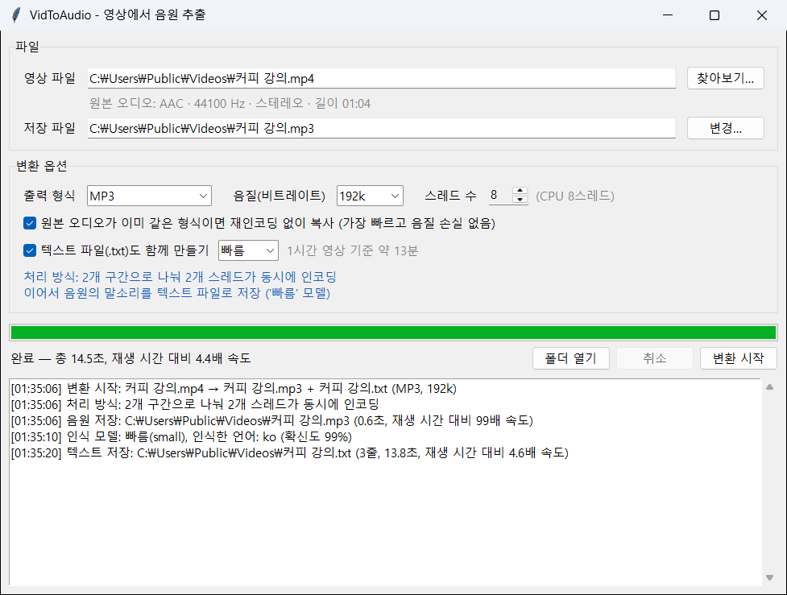
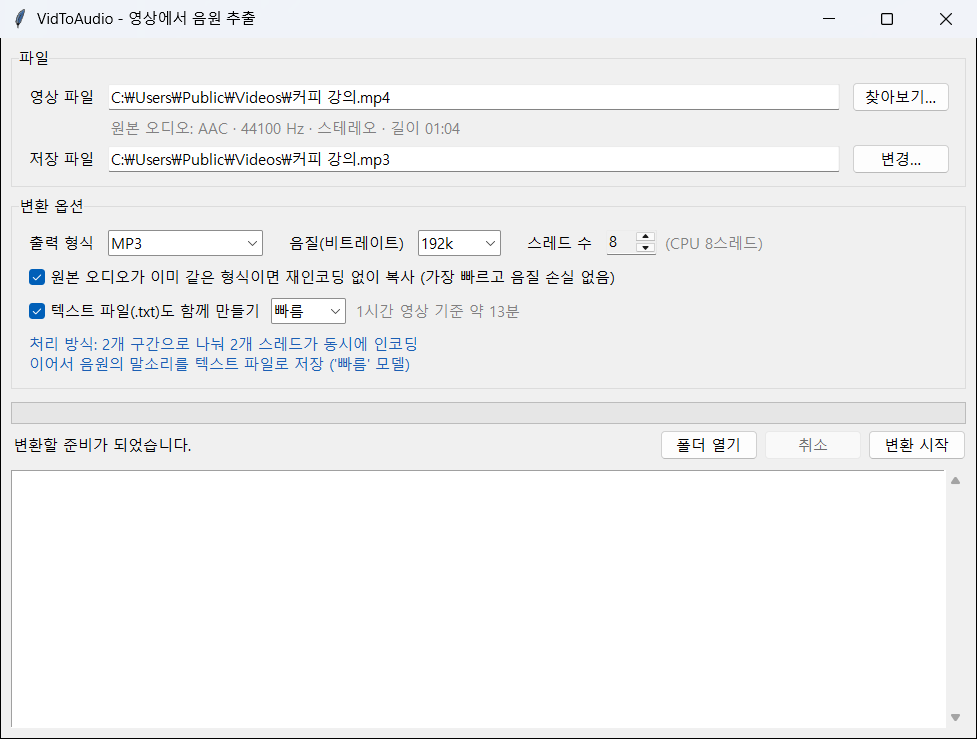

# VidToAudio — 영상에서 음원 추출

영상 파일 하나를 골라 오디오만 MP3 등의 음원 파일로 저장하는 프로그램입니다.
원하면 그 음원의 말소리를 인식해 텍스트 파일(.txt)도 함께 만듭니다.
여러 CPU 코어를 동시에 사용해 영상 하나를 빠르게 변환하며, ffmpeg는 자동으로 설치됩니다.



## 실행 방법

### Windows
**1. 프로그램 내려받기**

이 페이지 위쪽의 초록색 **Code** 버튼 → **Download ZIP**을 눌러 내려받습니다.
1. 받은 ZIP 파일을 오른쪽 클릭 → **속성**에서 맨 아래 **차단 해제**를 체크하고 **확인**을 누르세요. 이렇게 하면 실행할 때 Windows 경고 창이 뜨지 않습니다. 이 항목이 없으면 건너뛰세요.
2. ZIP 파일을 오른쪽 클릭 → **압축 풀기**(모두 압축 풀기)로 풉니다. 압축을 풀지 않고 ZIP 안에서 바로 실행하면 동작하지 않습니다.

**2. 실행**

압축을 푼 폴더에서 `run.bat`을 더블클릭하세요. Python을 따로 설치하지 않아도 됩니다.
- 파란색 "Windows의 PC 보호" 창이 뜨면 **추가 정보** → **실행**을 누르세요. 인터넷에서 받은 파일이라 처음 한 번 나오는 경고입니다.
- 처음 실행할 때 필요한 구성 요소(ffmpeg, 음성 인식)를 프로젝트 폴더의 `.venv`에 자동으로 설치합니다. 인터넷 연결이 필요하며 몇 분 걸립니다.
- 텍스트 변환은 64비트 Python 3.10~3.14에서만 동작합니다. 이런 Python이 없으면(Python이 없거나 3.15, 32비트만 있는 경우) `run.bat`이 휴대용 Python 3.14(64비트, 약 23MB)를 프로그램 폴더 안의 `.python`에 내려받아 씁니다. PC에 설치된 Python, PATH, `py` 기본 버전 같은 설정은 바꾸지 않습니다.
- 설치에 실패하면 창이 닫히지 않고 이유를 보여 줍니다. 자세한 기록은 폴더의 `install-log.txt`에 남습니다.
- 그다음부터는 바로 실행됩니다. 구성 요소가 빠졌거나 프로그램을 새 버전으로 바꿔 `requirements.txt`가 달라졌다면, 다음 실행 때 다시 설치합니다.
- 폴더를 `.venv`째로 다른 PC에 옮겨도 `run.bat`이 가상환경을 새로 만듭니다. `models` 폴더는 함께 옮기면 음성 인식 모델을 다시 받지 않아도 됩니다.

### 직접 실행 (macOS / Linux 포함)
```bash
pip install -r requirements.txt
python main.py
```
Python 3.10~3.14가 필요합니다. Linux에서 tkinter가 없다는 오류가 나면 `sudo apt install python3-tk`를 실행하세요.

## 사용법


1. **영상 파일**: "찾아보기…"로 영상을 고릅니다. 고르면 원본 오디오 정보(코덱, 샘플레이트, 채널, 길이)가 표시됩니다.
2. **저장 파일**: 기본값은 영상과 같은 폴더, 같은 이름에 확장자만 바꾼 파일입니다. 예: `강의.mp4` → `강의.mp3`. "변경…"으로 다른 위치나 이름을 지정할 수 있습니다.
3. **출력 형식, 음질, 스레드 수**를 고르면 아래에 실제로 어떻게 처리할지 표시됩니다.
4. 말소리를 글로 받아 두려면 **텍스트 파일(.txt)도 함께 만들기**를 체크합니다. 기본값은 꺼져 있습니다. 자세한 내용은 아래 [텍스트 변환](#텍스트-변환-음성-인식)을 참고하세요.
5. 확인 후 **변환 시작**을 누릅니다.

변환이 끝나면 맨 위 그림처럼 아래쪽 기록 창에 저장한 파일의 위치와 걸린 시간이 표시됩니다. **폴더 열기**를 누르면 저장한 파일이 있는 폴더가 열립니다.

## 지원 형식
| 구분 | 형식 |
|---|---|
| 입력 영상 | mp4, mkv, avi, mov, wmv, flv, webm, m4v, mpg, mpeg, ts, mts, m2ts, 3gp, ogv, vob |
| 출력 음원 | MP3, M4A(AAC), AAC, WAV, FLAC |

## 빠르게 변환하는 방법
처리 방식은 자동으로 정해지며, 화면의 "처리 방식"에 표시됩니다.

| 처리 방식 | 언제 | 속도 |
|---|---|---|
| **원본 복사** | 영상 속 오디오가 이미 출력 형식과 같을 때. 예: 대부분의 mp4 → M4A | 가장 빠름. 재인코딩하지 않아 음질 손실도 없음 |
| **분할 병렬 인코딩** | MP3, M4A, AAC로 변환할 때 (영상이 1분 이상이고 스레드 2개 이상) | 단일 작업보다 2.5~4배 빠름 (8스레드 CPU에서 측정) |
| **단일 작업** | 그 밖의 형식이나 짧은 영상 | ffmpeg 기본 속도 |

### 분할 병렬 인코딩의 원리
MP3, AAC 인코더는 원래 CPU 코어를 하나만 씁니다. 그래서 다음 순서로 처리합니다.
1. 오디오를 한 번만 디코딩해 임시 파일(PCM)에 저장합니다.
2. 오디오를 스레드 수만큼 구간으로 나눠 각 구간을 동시에 인코딩합니다.
3. 구간들을 이어 붙입니다.

이음새에서 소리가 튀거나 끊기지 않도록 다음처럼 처리합니다.
- 구간 경계를 코덱 프레임 크기의 배수에 맞춥니다.
- 각 구간을 앞뒤로 조금씩 겹쳐 인코딩하고, 겹친 부분을 버린 뒤 붙입니다.
- MP3는 프레임끼리 데이터를 나눠 담는 기능(bit reservoir)을 끕니다.

원본 신호와 비교해 측정한 결과, 이음새 부분의 음질은 단일 작업으로 인코딩한 것과 같은 수준입니다.

참고 사항:
- 임시 PCM 파일은 영상 1시간당 약 600MB이며, 변환이 끝나면 자동으로 지워집니다.
- 분할 인코딩한 파일은 맨 앞에 0.02초 정도의 무음이 붙습니다. 인코더 지연을 기록하는 헤더 정보를 옮길 수 없기 때문이며, 들어서 알 수 있는 수준은 아닙니다.
- 영상의 오디오가 5.1채널 같은 다채널이면 M4A/AAC는 채널을 유지하기 위해 단일 작업으로 처리합니다. MP3는 원래 스테레오까지만 지원합니다.

## 텍스트 변환 (음성 인식)
**텍스트 파일(.txt)도 함께 만들기**를 체크하면, 음원 변환이 끝난 뒤 그 음원의 말소리를 인식해 같은 폴더에 같은 이름의 텍스트 파일로 저장합니다. 예: `강의.mp3` → `강의.txt`

- 인터넷 없이 PC에서 처리합니다(Whisper 음성 인식 모델). 모델만 처음 쓸 때 한 번 내려받아 `models` 폴더에 저장합니다.
- 언어는 자동으로 알아냅니다.
- 말소리를 최대 30초 분량씩 끊어 한 줄에 하나씩 저장하며, 시간 정보는 넣지 않습니다. 메모장이나 한글(HWP)에서 바로 열 수 있습니다.

맨 위 그림의 1분짜리 영상으로 만든 텍스트 파일(`커피 강의.txt`)의 내용입니다.

> 안녕하세요. 오늘은 집에서 핸드드립 커피를 맛있게 내리는 방법을 알아보겠습니다. 먼저 원두는 내리기 직전에 갈아야 향이 살아있습니다. 물의 온도는 90도 정도가 적당하고 너무 뜨거우면 쓴맛이 강해집니다. 원두와 물의 비율은 1대15 정도로 맞추는 것이 좋습니다. 처음에는 물을 조금만 부어 30초 정도 뜸을 들이세요.
>
> 그 다음 가운데부터 바깥쪽으로 천천히 원을 그리며 물을 붓습니다. 전체 추출 시간은 2분 반에서 3분 사이가 적당합니다. 추출이 끝나면 한 번 저어 맛을 고르게 해주세요. 같은 원두라도 분쇄도와 물 온도에 따라 맛이 크게 달라지니 여러 번 시도해 보면서 자신에게 맞는 방법을 찾아보시기 바랍니다. 다음 시간에는 원두를 고르는 방법에 대해 알아보겠습니다.
>
> 감사합니다.

체크박스 옆에서 모델을 고를 수 있고, 고른 모델의 예상 시간이 함께 표시됩니다.

| 모델 | 1시간 영상 기준 | 내려받는 크기 | 특징 |
|---|---|---|---|
| **빠름** (기본값) | 약 13분 | 486MB | 또렷한 말소리는 잘 받아 적지만, 잡음이 많거나 말이 빠르거나 전문 용어가 많으면 틀리는 곳이 늘어납니다 |
| **정확** | 약 33분 | 1.6GB | 더 정확하지만 빠름보다 2.5배쯤 오래 걸립니다 |

시간은 4코어 8스레드 노트북(Intel Core i5-1135G7)에서 10분짜리 음성으로 측정해 1시간으로 환산했으며, PC 성능과 영상 속 말소리 양에 따라 달라집니다. 화면의 스레드 수 설정은 음성 인식에도 적용됩니다.

참고 사항:
- 변환 중에는 `[1/2]` 음원 변환, `[2/2]` 텍스트 변환 단계가 표시됩니다.
- 텍스트 변환 중에 취소하거나 실패해도 이미 저장한 음원 파일은 남습니다.
- 취소는 인식 중인 구간을 마친 뒤 반영되므로 몇십 초 걸릴 수 있습니다.
- 말소리가 없는 영상은 빈 텍스트 파일이 만들어집니다.
- 음성 인식은 틀릴 수 있습니다. 중요한 내용은 원본과 대조하세요.

### 텍스트 변환을 쓸 수 없을 때
체크박스 옆에 "텍스트 변환 구성 요소가 설치되지 않았습니다"가 보이면 다음을 확인하세요. 이 경우에도 음원 변환은 그대로 쓸 수 있습니다.
- 프로그램을 닫고 `run.bat`으로 다시 실행하세요. 빠진 구성 요소를 자동으로 설치하고, 지금 Python으로 텍스트 변환을 쓸 수 없으면(3.15, 32비트) 휴대용 Python 3.14를 내려받아 가상환경을 새로 만듭니다.
- **폴더 경로가 너무 긴 경우**: 프로그램 폴더 경로가 130자를 넘으면 Windows 경로 길이 제한 때문에 설치할 수 없으며, `run.bat`이 이 경우를 알려 줍니다. `C:\VidToAudio`처럼 짧은 위치로 폴더를 옮긴 뒤 `run.bat`을 다시 실행하세요.
- 그래도 안 되면 `.venv` 폴더를 지우고 `run.bat`을 다시 실행하면 처음부터 다시 설치합니다.

## 그 밖의 동작
- 저장 파일이 이미 있으면 덮어쓸지 묻습니다.
- 변환 중에는 `.part` 임시 파일에 쓰고, 성공했을 때만 최종 이름으로 바꿉니다. 취소하거나 실패하면 임시 파일을 지웁니다.
- 오디오 트랙이 없는 영상이나 손상된 파일은 원인을 알려 줍니다.

## 파일 구성
| 파일 | 내용 |
|---|---|
| `main.py` | GUI (tkinter) |
| `converter.py` | 오디오 분석, 처리 방식 결정, ffmpeg 실행, 분할 병렬 인코딩 |
| `transcriber.py` | 음성 인식 모델 내려받기, 음원 → 텍스트 변환 |
| `run.bat` | Windows 실행 스크립트 (첫 실행 때 필요하면 휴대용 Python을 받고, 가상환경과 구성 요소 설치까지 처리) |
| `run-messages.txt` | `run.bat`이 보여 주는 한국어 안내 문구 |
| `requirements.txt` | 의존성 (`imageio-ffmpeg`: ffmpeg 실행 파일 포함, `faster-whisper`: 음성 인식) |
| `models/` | 음성 인식 모델 (텍스트 변환을 처음 쓸 때 자동으로 생김) |
| `.python/` | 휴대용 Python (PC에 알맞은 Python이 없을 때 `run.bat`이 자동으로 만듦) |
| `docs/` | README에 넣은 화면 그림 |

## 라이선스
이 프로그램의 코드는 [MIT 라이선스](LICENSE)를 따릅니다. 설치나 첫 사용 때 자동으로 내려받는 Python, ffmpeg, faster-whisper, Whisper 모델은 각자의 라이선스를 따릅니다.
